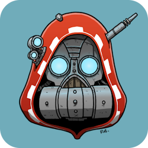

# omnissiah

The Omnissiah (pronounced _omni-sigh-ah_) is a thin, opinionated wrapper around
[Docker Sandboxes](https://docs.docker.com/ai/sandboxes/) for praying to machine spirits (a.k.a.
sandboxing AI agents).

> [!WARNING]
> This tool is deliberately playful with sci-fi references in command names. The author takes no
> responsibility for any feelings of cringe by users.

**Contents:**

- [Installation](#installation)
- [Usage](#usage)
- [Config](#config)
- [Maintainer's guide](#maintainers-guide)
- [Credits](#credits)

## Installation

1. [Install the Docker Sandboxes `sbx` CLI](https://docs.docker.com/ai/sandboxes/install)
    - On MacOS:
      ```
      brew trust docker/tap
      brew install docker/tap/sbx
      ```
2. Then, install `omnissiah`:
    - With [Go](https://go.dev/):
      ```
      go install hermannm.dev/omnissiah
      ```
    - With [Mise](https://mise.jdx.dev/), using the
      [Go backend](https://mise.jdx.dev/dev-tools/backends/go.html):
      ```
      mise use -g go:hermannm.dev/omnissiah
      ```
3. Run `omnissiah awaken` to initialize Omnissiah config and set `sbx` defaults
4. Edit `~/.config/omnissiah/config.yml` to configure your projects and default settings
   (see [Config](#config) below)
5. Run `omnissiah empower` to complete post-config setup
6. (Optional) Set `omni` alias for Omnissiah:
   ```shell
   alias omni='omnissiah'
   ```
7. (Later) When configuring new Omnissiah projects, run `omnissiah empower <project-name>` to
   bootstrap it

## Usage

Output of `omnissiah --help`:

```
USAGE:
   omnissiah [global options] [command [command options]]

COMMANDS:
   awaken           Initialize Omnissiah config and set sbx defaults
   empower          Post-config setup (model provider authentication, sbx network policies)
   pray, p, pp      Start a new Omnissiah session in the current Git repo
   commune, c       Commune with existing machine spirits
   cortex, cc       Open the Cybernetica Cortex: the machine spirit control center
   exterminatus, e  Commence Exterminatus on all machine spirits, killing them
   help, h          Shows a list of commands or help for one command
```

## Config

In `~/.config/omnissiah/config.yml` (generated by `omnissiah awaken`):

```yaml
# Set default model for all projects
# See "Available agents" in sbx docs: https://docs.docker.com/reference/cli/sbx/run/
defaultModel:
  name: claude
  # Args to pass to the agent (optional)
  # See Claude CLI reference: https://code.claude.com/docs/en/cli-reference
  args:
    - '--max-budget-usd=5.00'
  # Models are kits in sbx, so they can take kit arguments (formatted as key=value)
  # For example, the built-in claude kit takes a 'model' argument - see 'args:' here:
  # https://hub.docker.com/layers/sbx/claude/latest/images/latest/sbx-kit-spec
  kitArgs:
    - model=opus
# sbx kits to apply to all Omnissiah prayers (agent sessions)
# See sbx docs: https://docs.docker.com/ai/sandboxes/customize/use-kits/
defaultKits:
  - path: docker.io/example/example-kit:1.0.0
    # Kits may take arguments - formatted as key=value:
    # https://docs.docker.com/ai/sandboxes/customize/use-kits/#pass-arguments-to-kits
    args:
      - EXAMPLE_ARG=true
  # Kit paths may point to your file system, see sbx docs:
  # https://docs.docker.com/ai/sandboxes/customize/author/tool-mixins/
  # When doing this, you may have to configure Docker to use the `containerd` image store:
  # https://docs.docker.com/desktop/features/containerd/#switch-image-stores
  - path: ~/.config/omnissiah/kits/example
# Networks that we want to allow the machine spirit to connect to. The Omnissiah initializes the
# network policy to `deny-all`, and only allows networks in this list, for full control
# https://docs.docker.com/reference/cli/sbx/policy/allow/network/
allowedNetworks:
  - host: registry.npmjs.org
    # Restrict HTTP methods (default: all methods allowed)
    methods: [ GET ]
# Project config: `omnissiah pray` can only be used under these paths
# This is to avoid sharing unintended files with a machine spirit (AI agent)
projects:
  # Name is used as an identifier for project-related things, and cannot contain spaces
  - name: project1
    path: ~/project1
  - name: project2
    path: ~/project2
    # Use different model in this project
    model:
      name: codex
    # sbx kits to use for prayers in this project, in addition to `defaultKits`
    kits:
      - path: docker.io/example/example-kit-2:1.0.0
    # Commands to run as part of `omnissiah empower` when bootstrapping the project template
    # sbx docs on templates: https://docs.docker.com/reference/cli/sbx/template/
    bootstrap:
      # `cmd` runs the given command with `sbx` exec before saving the project template
      # `sbx exec` docs: https://docs.docker.com/reference/cli/sbx/exec/
      - cmd: pnpm install --frozen-lockfile
      # `cp` copies a file or directory from your host to the sandbox before saving the template
      # `sbx cp` docs: https://docs.docker.com/reference/cli/sbx/cp/
      - cp:
          from: ~/host-file-or-dir
          to: ~/sandbox-file-or-dir
```

## Maintainer's guide

### Publishing a new release

- Run tests and linter ([`golangci-lint`](https://golangci-lint.run/)):
  ```
  go test ./... && golangci-lint run
  ```
- Add an entry to `CHANGELOG.md` (with the current date)
    - Remember to update the link section, and bump the version for the `[Unreleased]` link
- Bump `Command.Version` in `main.go`
- Run `omnissiah --help` and update [Usage](#usage) if any new commands/options have been added
- Create commit and tag for the release (update `TAG` variable in below command):
  ```
  TAG=vX.Y.Z && git commit -m "Release ${TAG}" && git tag -a "${TAG}" -m "Release ${TAG}" && git log --oneline -2
  ```
- Push the commit and tag:
  ```
  git push && git push --tags
  ```
    - Our release workflow will then create a GitHub release with the pushed tag's changelog entry

## Credits

- [Robert "TheChirurgeon" Jones](https://www.tabletopbattles.com/author/thechirurgeon/) for the logo
